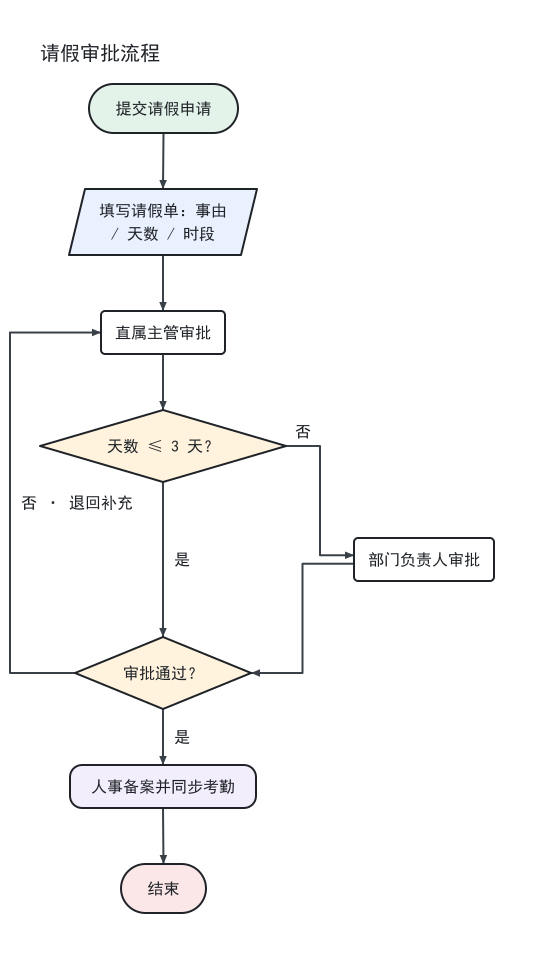
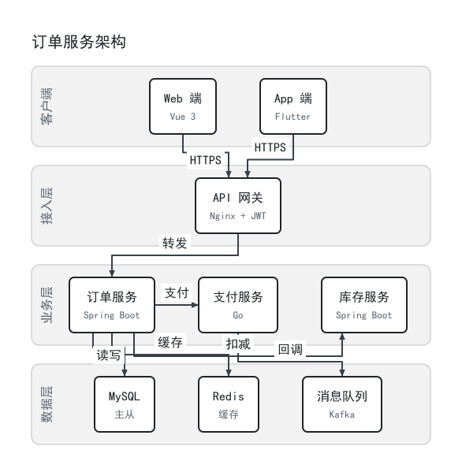
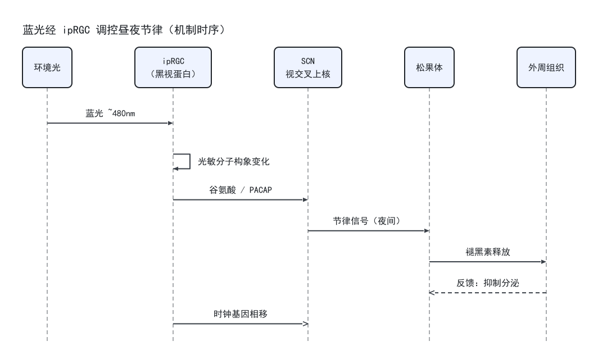

# simplechart

一个能真的画出 PNG 的流程图 / 思维导图 skill：**先量文字再定框、连线走正交端口、出图后自动自检**。

已支持 5 种图：**流程图 / 思维导图 / 时序图 / ER 图 / 架构图**。MIT License。

## 长什么样

**流程图**（判断双出口 + 退回回边）



**架构图**（4 层 / 9 模块 / 8 条依赖）



**时序图**（蓝光 → ipRGC → SCN → 松果体）



更多见 [`examples/`](examples/)（思维导图、ER 图、20 节点压力用例，每个都带 `spec.json`）。

## 它解决什么问题

大多数"让 AI 画图"的做法是现场写一段绘图代码，结果每次都不一样，而且**文字压边框、连线穿框、箭头反向**这类问题没人检查。

这个 skill 换了个思路：**把"画什么"（一份 JSON）和"怎么画"（渲染器）分开**。

- 文字先量好再定框 → 从根上不会溢出
- 连线走端口 + 回避框体 → 穿框直接判失败
- 出图后跑**几何 + 像素**两层自检 → 不是"看起来还行"，是 15 项检查的 PASS/FAIL
- 改图只改 JSON，重渲染是幂等的

## 装在哪

```bash
# 用户级（所有会话可见）
git clone https://github.com/L-XUN/simplechart.git ~/.dsh/skills/simplechart
```

没有 git 就下载 ZIP，把**里面的内容**放到 `~/.dsh/skills/simplechart/`（目录名叫什么无所谓，catalog 里的名字来自 SKILL.md 的 frontmatter）。

装完验证：开新会话问一句"你有哪些 skill"，或者直接打 `/simplechart 画一个三节点的流程图测试`。

必须是 `~/.dsh/skills/simplechart/SKILL.md` 这个层级；**放在更深一层不会被发现**（scanner 只认根目录下一层的 `SKILL.md` 或顶层 `<name>.md`）。

也可以用扁平文件方式：只把 `SKILL.md` 复制成 `~/.dsh/skills/simplechart.md`——但那样脚本和示例就跟着丢了，不推荐。

## 先试一下（不用开会话）

```powershell
cd "$HOME\.dsh\skills\simplechart"
node scripts/render.mjs examples/approval-flow/spec.json out.png
```

正常输出长这样：

```
simplechart 出图 · examples/approval-flow/spec.json
  画布 534 × 953 px · 节点 8 · 连线 9 · 字体 SimHei 16
  [通过] 标签完整 — 8 个节点都有文字
  ...
  结论：PASS
```

出问题会明确告诉你哪条规则破了，例如：

```
  [失败] 连线不得穿过线框 — d2→p1 穿过 d1
  结论：FAIL（1 项失败）
```

退出码：`0` 通过，`1` 自检失败，`2` 参数/依赖问题。

## 目录

```
simplechart/
├── SKILL.md              入口：类型路由表 + 通用规则 + 流程图/思维导图 spec
├── README.md             给你看的这份
├── references/
│   ├── sequence.md       时序图的差异规则（格式、硬规则、常见错误）
│   ├── er.md             ER 图的差异规则（字段、主键、基数、常见错误）
│   └── arch.md           架构图的差异规则（分层、模块、依赖、常见错误）
├── scripts/
│   ├── spec.mjs          类型路由：按 spec.type 选排版模块（加类型只改这 +1 行）
│   ├── layout.mjs        几何内核：量字、换行、定框、网格排版、选口布线
│   ├── layout-sequence.mjs  时序图排版：参与者列 + 消息行
│   ├── svg-sequence.mjs  时序图绘制：生命线、箭头、自调用
│   ├── layout-er.mjs     ER 排版：实体网格 + 字段行 + 关系线 + 基数
│   ├── svg-er.mjs        ER 绘制：表头、字段、基数与关系动词
│   ├── layout-arch.mjs   架构排版：层容器 + 模块行 + 依赖连线
│   ├── svg-arch.mjs      架构绘制：层底、模块、技术栈灰字、箭头
│   ├── render.mjs        spec → SVG → PNG（sharp），画完自动自检
│   └── check.mjs         自检：结构 / 几何 / 像素三层
└── examples/
    ├── approval-flow/    8 节点审批流（判断双出口 + 退回回边）
    ├── team-mindmap/     15 节点思维导图（左右平衡 + 分支配色）
    ├── stress-20/        20 节点压力用例（长标签 + 三条回边）
    ├── iprgc-sequence/   时序图（蓝光 → ipRGC → SCN → 松果体）
    ├── shop-er/          ER 图（用户 / 订单 / 明细 / SKU / 地址）
    └── service-arch/     架构图（4 层 / 9 模块 / 8 条依赖）
```

## 依赖

- Node 18+（本机 v24）
- `sharp`（PNG 渲染）和 `fontkit`（精确量字宽）——
  **DSH 自带这两个包**，脚本会自动去 `%APPDATA%\npm\node_modules\@deepseek-ai\dsh\node_modules` 找，不用 `npm install`。
- 中文字体：优先 `C:\Windows\Fonts\simhei.ttf`（黑体），找不到依次退到微软雅黑 / 等线 / Noto Sans SC。
  找不到任何中文字体会自动降级成"估算字宽"并警告——那时必须回看图片确认没有豆腐块。

## 相对原版的改动（逐条对应）

**不改不行的（原版会直接失效）**

1. frontmatter 修好：`name:simplechart` → `name: simplechart`（缺空格会让 YAML 把三行折叠成一个字符串，整个 skill 被静默丢弃）；`version` 挪进 `metadata`（加载器不认顶层 `version`）。
2. `description` 重写：原版"绘制png格式时的思维导图,流程图"没有触发词，模型不知道该在什么时候用；现在写清了做什么 + 什么时候用 + 不适用什么（时序图/UML/ER/甘特/架构图）。
3. 补上了**怎么画**：原版只说"保存为 .png"，没有渲染器、没有依赖、没有代码。现在有 `scripts/`，并且实测可跑。

**规则从"要求"变成"可判定"**

4. "文字不得超过线框" → 先量字再定框；自检按每种形状的几何（菱形斜边、胶囊圆弧、平行四边形斜边）逐个算内切，不是简单内缩。
5. "连线除端点外不得与方框相交" → 端点落在框边端口上，其余部分与所有非端点框保持 ≥4px，脚本采样验证。
6. "弯折过多则用曲线" → 给了数：≤2 个拐点；走不通就绕图外侧或列间通道；同一侧多条线自动错开，避免叠线。
7. "粗细适中且一致" → 定死 2px / 箭头 9px。
8. "圆角矩形可点击展开" → 删掉（PNG 点不了），改成"拆成两张图"。
9. "只能从左到右、从上到下" → 保留为主流向，但**允许回边**（退回/重试），并规定走外侧通道，否则真实流程画不出来。
10. 判断出口补上"必须标 是/否"，并写进自检。
11. 思维导图原来只有配色三条，现在补全布局规则：中心 + 左右交替、深度 ≤4、只用矩形、连线不带箭头、分支继承配色。
12. 颜色从"任意颜色"收紧成语义色板 + 文字对比度 ≥4.5:1（脚本会算对比度）。

**流程上的坑**

13. 绘制顺序改成"量文字 → 定框 → 排版 → 画框 → 连线"（原版先画框后写字，必然溢出）。
14. 自检三条主观判断 → 脚本三层检查（结构 / 几何 / 像素）+ 人眼复核四项，FAIL 有明确修法表。
15. 落盘位置给了命名规范和不覆盖约定，不再往工程目录里乱丢文件。
16. 检索环节加了防幻觉要求：查不到写 `[待确认]`，不许编数字。
17. 补了范围声明：UML/ER/甘特/架构图不在范围内。

## 扩展记录：两次加类型，动了什么

### v1.1 加时序图（第一次实战）

| 动作 | 文件 | 量 |
|---|---|---|
| 新增类型规则 | `references/sequence.md` | 新文件，约 90 行 |
| 新增排版算法 | `scripts/layout-sequence.mjs` | 新文件，约 180 行 |
| 新增绘制代码 | `scripts/svg-sequence.mjs` | 新文件，约 130 行 |
| 类型路由 | `scripts/spec.mjs` | **新文件**，约 40 行（把分发从 layout.mjs 抽出来） |
| 登记新类型 | `spec.mjs` 的一张表 + `render.mjs` 一行 `if` + `check.mjs` 一个分支 | 十几行 |
| 入口说明 | `SKILL.md`：description 加触发词、加路由表、加两行指针 | 约 20 行 |
| 示例 | `examples/iprgc-sequence/` | 1 个 spec |

### v1.2 加 ER 图（验证第二次不需要改架构）

| 动作 | 文件 | 量 |
|---|---|---|
| 新增类型规则 | `references/er.md` | 新文件，约 85 行 |
| 新增排版 + 绘制 | `scripts/layout-er.mjs`、`scripts/svg-er.mjs` | 新文件，约 300 行 |
| 登记新类型 | `spec.mjs` 别名表 +1 行、`render.mjs` +1 行 `if`、`check.mjs` +1 个分支 | **不到 60 行** |
| 入口说明 | `SKILL.md`：description、路由表一行、指针两行、常见问题两行 | 约 15 行 |
| 示例 | `examples/shop-er/` | 1 个 spec |

两次都没有改 `layout.mjs` 的流程图/思维导图排版，也没有改几何与像素检查的主体。**五个示例全部回归通过。**

### v1.3 加架构图（第一次碰"框套框"）

| 动作 | 文件 | 量 |
|---|---|---|
| 新增类型规则 | `references/arch.md` | 新文件，约 85 行 |
| 新增排版 + 绘制 | `scripts/layout-arch.mjs`、`scripts/svg-arch.mjs` | 新文件，约 400 行 |
| 登记新类型 | `spec.mjs` 别名表 +1 行、`render.mjs` +1 行、`check.mjs` +1 个分支 | **不到 70 行** |
| 入口说明 | `SKILL.md`：description、路由表一行、指针两行、常见问题两行 | 约 15 行 |
| 示例 | `examples/service-arch/` | 1 个 spec |

架构图带来一个新概念：**容器**（层）。于是多了一条前面三类都没有的规则——「模块必须落在自己的层里」，以及一条新的几何检查——「连线不能和模块边框重合」（防止布线退化时把线画成框线加粗）。**六个示例全部回归通过。**

三点值得记住：

1. **新类型的 spec 结构放在 reference 里，入口只给一行指针**——故意的。没读就写 `nodes`/`edges`，渲染器直接报"需要 entities/actors/layers"。**漂移不靠自觉，靠跑不通。**
2. 流程图和思维导图仍在 SKILL.md 正文里，**没有顺手搬进 references**——搬是重构，要单独做并回归。先扩展、后重构。
3. 每加一个类型，**先写 reference（含可跑的 spec 片段），再写代码**。反过来的话，代码里会长出一堆"这个字段当时怎么想"的考古问题。

### 已知技术债（下次重构的清单）

- **布线逻辑现在有三份**（流程图、ER、架构图各一份）。"规则三"触发了，该抽成 `routing.mjs`——但抽要和回归一起做，不能顺手改。
- 边标签的避让重了两遍（流程图、架构图各一份），同样待抽。
- 流程图 + 思维导图还在 SKILL.md 正文里，等一次专门的重构搬进 references。

## 已知边界

- 流程图是**网格布局**（`row`/`col`），不是自动图布局算法。节点多了要自己排格子，排得不好线会绕远。
- 回边只走外侧和列间通道；如果两条回边挤在同一侧，会看到并行线靠得比较近。
- 边标签只避开线框、不避开其他连线，密图里偶尔会压到别的线（有背景色挖空，仍可读）。
- 不支持富文本（粗体/颜色局部）、图标、图片节点。
- 只用一种字号：想强调就用标题或拆图。
- 时序图还不支持：激活条（激活期）、`alt`/`loop`/`opt` 组合框、消息序号、注释块。要分支就拆图或用流程图。
- 时序图消息标签允许压过生命线（标准画法，标签底下有背景色挖空）；列距固定 112px，参与者超过 6 个会嫌挤。
- ER 图是**网格布局**（`row`/`col` 或 `perRow` 自动排），关系线只做"直 / Z 型 / 兜底 L 型"，不做全局最优布线；实体多时线会绕。
- ER 图**不画**索引、唯一约束、外键约束、字符集、注释；`N:M` 需要你自己画出中间表（推荐），或只在 `label` 里说明。
- ER 自关联从实体**下方**绕出；下方有实体时要留空一行，否则会重叠。
- ER 建议每个实体不超过 8 个字段（超了会给 WARN），实体不超过 8 个。
- 架构图是**单层容器**：层里只能放模块，不支持子层嵌套；每层一行模块（≤5 个），不做自动换行。
- 架构图的层名**竖排在左侧留白带**里（横排会被跨层连线穿过，这是第一版踩到的坑）；留白带是连线的禁区，有自检兜着。
- 架构图的跨层链路如果左右两侧都被占满，会被挤成绕画布外框的一条长线；这时更好的做法是拆图。
- 架构图的布线是**贪心**的：按 spec 里 `links` 的先后顺序逐条走，先画的线有优先权，后画的绕开它们。所以换一下 `links` 的顺序，可能得到不同的走线。
- 架构图不画部署信息（IP / 端口 / 容器编排）——那属于部署图，超出了本 skill 的范围。
